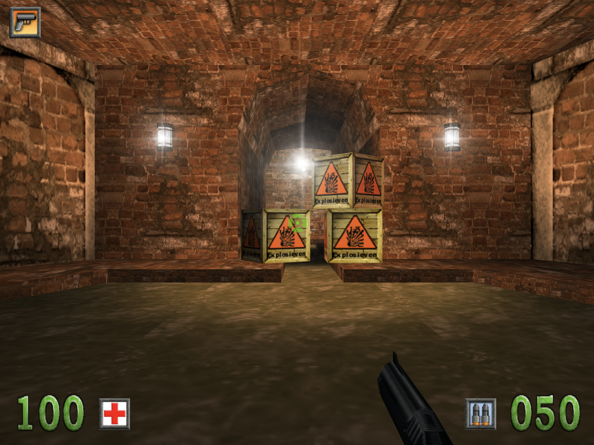

# Amsterdoom — Mac port

Play **Amsterdoom** (the Dutch first-person shooter from 2000, set in Amsterdam) on a modern
Mac.

<p>
  
  
</p>

This repository contains only the **port**: the game program rebuilt as a native Mac app
(`Amsterdoom.app`, OpenGL). It contains **none of the game's files** (levels, graphics, sounds,
music, the intro film). To play, you need **your own copy of Amsterdoom**: the original CD, or a
folder where the game is installed.

## Playing

1. Download the repository (see [Getting it](#getting-it) below) and double-click
   **Amsterdoom.app**. A start window opens.
2. Read in the game, in one of two ways:
    - **Cd inlezen / Read in the CD**: put the Amsterdoom CD in the drive (an external USB drive
      is fine, as is a mounted image of the CD). The window finds the CD by itself; the button
      shows which disc it found.
    - **Kies de cd-map… / Choose the CD folder…**: choose the folder of your Amsterdoom CD, or
      the folder the game is installed in. The app finds the game in it by itself (it looks
      for `Adamwin.ini`, which on the CD is in `Target Files`).

    The files are copied to `~/Library/Application Support/Amsterdoom/GameData` on this Mac.
    **They are not uploaded or sent anywhere.** Reading in takes from a few seconds to a few
    minutes from a CD (around 220 MB).
3. Click **Klik om te spelen** (or press Return). The game starts fullscreen.

On later starts the start window shows **Klik om te spelen** straight away; the CD is no longer
needed. Saved players are kept in `~/Library/Application Support/Amsterdoom/Amsterdoom/`. To
remove the game files, use the link in the start window ("remove the game files from this
Mac"); your saved players stay.

The game is in Dutch. It shows the game's 4:3 picture as large as the screen allows, with black
bars at the sides on wide displays. In the menu, **Opties → Weergave** lowers the 3D resolution
if a Mac is too slow.

## Getting it

**Requirements:** a Mac with Apple silicon or an Intel processor, and macOS 15 Sequoia or later.

- **With git** (simplest, macOS does not ask anything):

    ```sh
    git clone https://github.com/DavidStolk/amsterdoom-mac-port.git
    open amsterdoom-mac-port/Amsterdoom.app
    ```

- **As a ZIP**: **Code → Download ZIP**, then unpack it. The app is not signed by a registered
  Apple developer, so the first time macOS refuses to open it ("Apple could not verify…"):
  click **Done**, open **System Settings → Privacy & Security**, scroll down and click
  **Open Anyway** next to the message about Amsterdoom, then confirm. Or, in Terminal:

    ```sh
    xattr -dr com.apple.quarantine /path/to/Amsterdoom.app
    ```

You can move `Amsterdoom.app` anywhere, for example to Applications.

Add options after `--args` to start it from Terminal, for example without the intro film:

```sh
open Amsterdoom.app --args --no-intro
```

## Controls

The original defaults; change them in the menu under **Opties → Besturing**.

**Game controller** (Xbox, PS5 and compatible) works too.

## Troubleshooting

- **The CD button stays grey ("no Amsterdoom CD found")**: wait until the CD shows up in the
  Finder; the button follows the drives by itself. Otherwise choose the CD with **Choose the CD
  folder…**.
- **"No Amsterdoom found in this folder"**: choose the CD itself, its `Target Files` folder, or
  the folder of the installed game. The game folder needs `Adamwin.ini`, `AdamWin.exe`,
  `AdamMenu.exe` and the `Levels` folder.
- **"Reading failed"**: a scratched CD, or too little free disk space (about 220 MB is needed).
  Try again, or copy the CD to a folder first and choose that.
- **macOS says the app is damaged or cannot be checked**: see [Getting it](#getting-it).
- **The mouse does not turn**: click into the game. Esc releases the mouse again.

## Legal

Amsterdoom, its name, levels, graphics, sounds, music and film are the property of their rights
holders. This repository contains none of them; you need your own copy of the game to play.

The engine is **Genesis3D 1.0** (Genesis3D Public License, see `LICENSE-Genesis3D.txt`). Also
used: **SDL2** (zlib license), **pl_mpeg** (MIT license) and **stb_truetype** (MIT license or
public domain). Their license texts are in `THIRD-PARTY-LICENSES.txt`.
